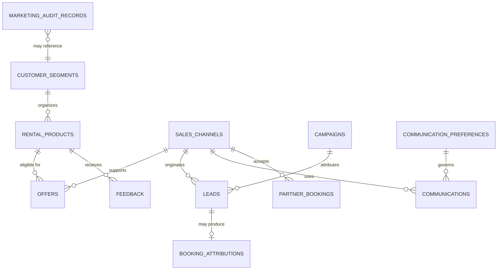

# Database Design - Marketing Role

## Table of Contents

- [Entity Relationship Diagram](#entity-relationship-diagram)
- [Tables](#tables)
  - [customer_segments](#customer_segments)
  - [rental_products](#rental_products)
  - [sales_channels](#sales_channels)
  - [offers](#offers)
  - [campaigns](#campaigns)
  - [leads](#leads)
  - [booking_attributions](#booking_attributions)
  - [communication_preferences](#communication_preferences)
  - [communications](#communications)
  - [partner_bookings](#partner_bookings)
  - [feedback](#feedback)
  - [marketing_audit_records](#marketing_audit_records)

## Entity Relationship Diagram

## Tables

### customer_segments

| Field Name | Data Type | Index | Database Constraints | Description |
| --- | --- | --- | --- | --- |
| id | TEXT | Primary | Not null | Opaque segment identifier. |
| name | TEXT | Unique | Not null | Approved segment name. |
| description | TEXT |  |  | Business description of the segment. |
| status | TEXT | Index | Not null | Active, disabled, or other approved status. |
| purpose | TEXT |  | Not null | Approved marketing purpose for the segment. |
| created_at | TIMESTAMP WITH TIME ZONE |  | Not null | Record creation timestamp. |
| updated_at | TIMESTAMP WITH TIME ZONE |  | Not null | Record update timestamp. |
| deleted_at | TIMESTAMP WITH TIME ZONE |  |  | Soft-delete timestamp. |
| created_by | TEXT |  | Not null | Identifier of the creator. |
| updated_by | TEXT |  | Not null | Identifier of the last updater. |
| deleted | BOOLEAN | Index | Not null, default false | Soft-delete flag. |

### rental_products

| Field Name | Data Type | Index | Database Constraints | Description |
| --- | --- | --- | --- | --- |
| id | TEXT | Primary | Not null | Opaque product identifier. |
| name | TEXT |  | Not null | Customer-facing product name. |
| rental_type | TEXT | Index | Not null | Daily, weekly, one-way, airport, long-term, or corporate. |
| segment_id | TEXT | Foreign key, index |  | Approved customer segment identifier. |
| display_attributes | JSONB |  |  | Approved customer-facing vehicle and rental attributes. |
| booking_status | TEXT | Index | Not null | Approved, draft, suspended, or disabled. |
| effective_from | TIMESTAMP WITH TIME ZONE |  | Not null | Start of approved customer-facing availability. |
| effective_to | TIMESTAMP WITH TIME ZONE |  |  | End of approved customer-facing availability. |
| created_at | TIMESTAMP WITH TIME ZONE |  | Not null | Record creation timestamp. |
| updated_at | TIMESTAMP WITH TIME ZONE |  | Not null | Record update timestamp. |
| deleted_at | TIMESTAMP WITH TIME ZONE |  |  | Soft-delete timestamp. |
| created_by | TEXT |  | Not null | Identifier of the creator. |
| updated_by | TEXT |  | Not null | Identifier of the last updater. |
| deleted | BOOLEAN | Index | Not null, default false | Soft-delete flag. |

### sales_channels

| Field Name | Data Type | Index | Database Constraints | Description |
| --- | --- | --- | --- | --- |
| id | TEXT | Primary | Not null | Opaque channel identifier. |
| name | TEXT |  | Not null | Channel name. |
| channel_type | TEXT | Index | Not null | Website, app, call center, agency, OTA, corporate, or approved other. |
| phase_one_status | TEXT | Index | Not null | Disabled, pending approval, or enabled. |
| booking_flow | TEXT |  | Not null | Approved booking-flow reference. |
| owner | TEXT |  | Not null | Accountable channel owner. |
| attribution_method | TEXT |  | Not null | Approved attribution method reference. |
| privacy_rules | JSONB |  |  | Approved data-sharing and retention rules. |
| created_at | TIMESTAMP WITH TIME ZONE |  | Not null | Record creation timestamp. |
| updated_at | TIMESTAMP WITH TIME ZONE |  | Not null | Record update timestamp. |
| deleted_at | TIMESTAMP WITH TIME ZONE |  |  | Soft-delete timestamp. |
| created_by | TEXT |  | Not null | Identifier of the creator. |
| updated_by | TEXT |  | Not null | Identifier of the last updater. |
| deleted | BOOLEAN | Index | Not null, default false | Soft-delete flag. |

### offers

| Field Name | Data Type | Index | Database Constraints | Description |
| --- | --- | --- | --- | --- |
| id | TEXT | Primary | Not null | Opaque offer identifier. |
| code | TEXT | Unique, index |  | Optional customer-facing coupon code. |
| name | TEXT |  | Not null | Offer name. |
| offer_type | TEXT | Index | Not null | Coupon, loyalty, bundle, referral, partner, or approved other. |
| eligibility_rules | JSONB |  | Not null | Segments, products, channels, stacking, and redemption conditions. |
| valid_from | TIMESTAMP WITH TIME ZONE |  | Not null | Offer start timestamp. |
| valid_to | TIMESTAMP WITH TIME ZONE |  |  | Offer end timestamp. |
| redemption_limit | INTEGER |  | Non-negative if present | Maximum redemptions where configured. |
| terms | TEXT |  | Not null | Customer-facing terms. |
| status | TEXT | Index | Not null | Draft, approved, active, expired, or disabled. |
| created_at | TIMESTAMP WITH TIME ZONE |  | Not null | Record creation timestamp. |
| updated_at | TIMESTAMP WITH TIME ZONE |  | Not null | Record update timestamp. |
| deleted_at | TIMESTAMP WITH TIME ZONE |  |  | Soft-delete timestamp. |
| created_by | TEXT |  | Not null | Identifier of the creator. |
| updated_by | TEXT |  | Not null | Identifier of the last updater. |
| deleted | BOOLEAN | Index | Not null, default false | Soft-delete flag. |

### campaigns

| Field Name | Data Type | Index | Database Constraints | Description |
| --- | --- | --- | --- | --- |
| id | TEXT | Primary | Not null | Opaque campaign identifier. |
| name | TEXT |  | Not null | Campaign name. |
| campaign_type | TEXT |  | Not null | Approved campaign classification. |
| status | TEXT | Index | Not null | Draft, active, paused, completed, or disabled. |
| channel_id | TEXT | Foreign key, index |  | Primary channel identifier. |
| cost_amount | DECIMAL(15, 2) |  | Non-negative if present | Campaign cost for acquisition reporting. |
| cost_currency | TEXT |  | Valid ISO 4217 if cost is present | Currency for campaign cost. |
| attribution_model_version | TEXT |  |  | Version of approved attribution configuration. |
| metadata | JSONB |  |  | Approved campaign metadata. |
| created_at | TIMESTAMP WITH TIME ZONE |  | Not null | Record creation timestamp. |
| updated_at | TIMESTAMP WITH TIME ZONE |  | Not null | Record update timestamp. |
| deleted_at | TIMESTAMP WITH TIME ZONE |  |  | Soft-delete timestamp. |
| created_by | TEXT |  | Not null | Identifier of the creator. |
| updated_by | TEXT |  | Not null | Identifier of the last updater. |
| deleted | BOOLEAN | Index | Not null, default false | Soft-delete flag. |

### leads

| Field Name | Data Type | Index | Database Constraints | Description |
| --- | --- | --- | --- | --- |
| id | TEXT | Primary | Not null | Opaque lead identifier. |
| channel_id | TEXT | Foreign key, index | Not null | Approved originating channel. |
| source_id | TEXT | Index |  | Approved source taxonomy identifier. |
| campaign_id | TEXT | Foreign key, index |  | Known attributed campaign identifier. |
| partner_id | TEXT | Index |  | Known originating partner identifier. |
| customer_identifier | TEXT | Index |  | Approved pseudonymous or authorized customer identifier. |
| status | TEXT | Index | Not null | New, qualified, converted, closed, or unknown. |
| attribution_status | TEXT |  | Not null | Complete or limited. |
| touchpoint_metadata | JSONB |  |  | Approved, purpose-limited attribution metadata. |
| created_at | TIMESTAMP WITH TIME ZONE |  | Not null | Record creation timestamp. |
| updated_at | TIMESTAMP WITH TIME ZONE |  | Not null | Record update timestamp. |
| deleted_at | TIMESTAMP WITH TIME ZONE |  |  | Soft-delete timestamp. |
| created_by | TEXT |  | Not null | Identifier of the creator. |
| updated_by | TEXT |  | Not null | Identifier of the last updater. |
| deleted | BOOLEAN | Index | Not null, default false | Soft-delete flag. |

### booking_attributions

| Field Name | Data Type | Index | Database Constraints | Description |
| --- | --- | --- | --- | --- |
| id | TEXT | Primary | Not null | Opaque attribution identifier. |
| lead_id | TEXT | Foreign key, unique, index |  | Lead identifier when applicable. |
| booking_id | TEXT | Unique, index |  | Booking system identifier. |
| channel_id | TEXT | Foreign key, index | Not null | Known originating or booking channel. |
| campaign_id | TEXT | Foreign key, index |  | Known campaign identifier. |
| partner_id | TEXT | Index |  | Known partner identifier. |
| model_version | TEXT |  | Not null | Attribution model version used. |
| lookback_window | TEXT |  |  | Approved attribution-window reference. |
| attribution_status | TEXT |  | Not null | Complete or limited; unknown values remain explicit. |
| attributed_at | TIMESTAMP WITH TIME ZONE |  | Not null | Attribution timestamp. |
| created_at | TIMESTAMP WITH TIME ZONE |  | Not null | Record creation timestamp. |
| updated_at | TIMESTAMP WITH TIME ZONE |  | Not null | Record update timestamp. |
| deleted_at | TIMESTAMP WITH TIME ZONE |  |  | Soft-delete timestamp. |
| created_by | TEXT |  | Not null | Identifier of the creator. |
| updated_by | TEXT |  | Not null | Identifier of the last updater. |
| deleted | BOOLEAN | Index | Not null, default false | Soft-delete flag. |

### communication_preferences

| Field Name | Data Type | Index | Database Constraints | Description |
| --- | --- | --- | --- | --- |
| id | TEXT | Primary | Not null | Opaque preference identifier. |
| customer_identifier | TEXT | Unique, index | Not null | Approved pseudonymous customer identifier. |
| marketing_consent | BOOLEAN |  | Not null | Marketing consent status. |
| channel_preferences | JSONB |  | Not null | Approved channel opt-in and opt-out settings. |
| consent_version | TEXT |  | Not null | Version of the consent notice accepted. |
| consented_at | TIMESTAMP WITH TIME ZONE |  |  | Time marketing consent was granted. |
| withdrawn_at | TIMESTAMP WITH TIME ZONE |  |  | Time marketing consent was withdrawn. |
| locale | TEXT |  |  | Approved communication locale. |
| created_at | TIMESTAMP WITH TIME ZONE |  | Not null | Record creation timestamp. |
| updated_at | TIMESTAMP WITH TIME ZONE |  | Not null | Record update timestamp. |
| deleted_at | TIMESTAMP WITH TIME ZONE |  |  | Soft-delete timestamp. |
| created_by | TEXT |  | Not null | Identifier of the creator. |
| updated_by | TEXT |  | Not null | Identifier of the last updater. |
| deleted | BOOLEAN | Index | Not null, default false | Soft-delete flag. |

### communications

| Field Name | Data Type | Index | Database Constraints | Description |
| --- | --- | --- | --- | --- |
| id | TEXT | Primary | Not null | Opaque communication identifier. |
| communication_type | TEXT | Index | Not null | Service or marketing communication purpose. |
| channel_id | TEXT | Foreign key, index | Not null | Delivery channel identifier. |
| preference_id | TEXT | Foreign key, index |  | Associated communication preference. |
| recipient_identifier | TEXT | Index | Not null | Approved pseudonymous recipient identifier. |
| booking_id | TEXT | Index |  | Related booking identifier when applicable. |
| rental_id | TEXT | Index |  | Related rental identifier when applicable. |
| template_id | TEXT |  | Not null | Approved template identifier. |
| content_version | TEXT |  | Not null | Template and content version. |
| status | TEXT | Index | Not null | Draft, queued, sent, delivered, failed, suppressed, or cancelled. |
| purpose_reference | TEXT |  | Not null | Consent or service-purpose reference. |
| scheduled_at | TIMESTAMP WITH TIME ZONE |  |  | Scheduled delivery timestamp. |
| sent_at | TIMESTAMP WITH TIME ZONE |  |  | Actual send timestamp. |
| created_at | TIMESTAMP WITH TIME ZONE |  | Not null | Record creation timestamp. |
| updated_at | TIMESTAMP WITH TIME ZONE |  | Not null | Record update timestamp. |
| deleted_at | TIMESTAMP WITH TIME ZONE |  |  | Soft-delete timestamp. |
| created_by | TEXT |  | Not null | Identifier of the creator. |
| updated_by | TEXT |  | Not null | Identifier of the last updater. |
| deleted | BOOLEAN | Index | Not null, default false | Soft-delete flag. |

### partner_bookings

| Field Name | Data Type | Index | Database Constraints | Description |
| --- | --- | --- | --- | --- |
| id | TEXT | Primary | Not null | Opaque partner booking identifier. |
| partner_id | TEXT | Index | Not null | Approved partner identifier. |
| campaign_id | TEXT | Foreign key, index |  | Partner campaign identifier when known. |
| channel_id | TEXT | Foreign key, index | Not null | Partner sales channel identifier. |
| booking_id | TEXT | Unique, index | Not null | Booking system identifier. |
| communication_owner | TEXT |  | Not null | Partner or direct platform owner. |
| servicing_owner | TEXT |  | Not null | Booking change and cancellation owner. |
| data_sharing_rules | JSONB |  | Not null | Approved purpose and field-sharing configuration. |
| status | TEXT | Index | Not null | Received, confirmed, changed, cancelled, or failed. |
| created_at | TIMESTAMP WITH TIME ZONE |  | Not null | Record creation timestamp. |
| updated_at | TIMESTAMP WITH TIME ZONE |  | Not null | Record update timestamp. |
| deleted_at | TIMESTAMP WITH TIME ZONE |  |  | Soft-delete timestamp. |
| created_by | TEXT |  | Not null | Identifier of the creator. |
| updated_by | TEXT |  | Not null | Identifier of the last updater. |
| deleted | BOOLEAN | Index | Not null, default false | Soft-delete flag. |

### feedback

| Field Name | Data Type | Index | Database Constraints | Description |
| --- | --- | --- | --- | --- |
| id | TEXT | Primary | Not null | Opaque feedback identifier. |
| rental_id | TEXT | Unique, index | Not null | Rental identifier associated with the feedback. |
| product_id | TEXT | Foreign key, index |  | Product identifier for aggregate analysis. |
| customer_identifier | TEXT | Index |  | Approved pseudonymous identifier. |
| rating | INTEGER | Index | Not null, from 1 through an approved maximum | Customer rating. |
| comment | TEXT |  |  | Approved optional feedback comment. |
| channel_id | TEXT | Foreign key, index |  | Feedback submission channel. |
| locale | TEXT |  |  | Locale used for the feedback request. |
| submitted_at | TIMESTAMP WITH TIME ZONE |  | Not null | Feedback submission timestamp. |
| created_at | TIMESTAMP WITH TIME ZONE |  | Not null | Record creation timestamp. |
| updated_at | TIMESTAMP WITH TIME ZONE |  | Not null | Record update timestamp. |
| deleted_at | TIMESTAMP WITH TIME ZONE |  |  | Soft-delete timestamp. |
| created_by | TEXT |  | Not null | Identifier of the creator or submitter. |
| updated_by | TEXT |  | Not null | Identifier of the last updater. |
| deleted | BOOLEAN | Index | Not null, default false | Soft-delete flag. |

### marketing_audit_records

| Field Name | Data Type | Index | Database Constraints | Description |
| --- | --- | --- | --- | --- |
| id | TEXT | Primary | Not null | Opaque audit-record identifier. |
| actor_id | TEXT | Index | Not null | Authenticated actor or service identity. |
| action | TEXT | Index | Not null | Action performed. |
| object_type | TEXT | Index | Not null | Type of object affected. |
| object_id | TEXT | Index |  | Identifier of the affected object. |
| purpose | TEXT |  | Not null | Approved purpose for the action or export. |
| result | TEXT |  | Not null | Approved, denied, failed, or completed result. |
| correlation_id | TEXT | Index | Not null | Request or trace identifier. |
| details | JSONB |  |  | Non-sensitive action details. |
| occurred_at | TIMESTAMP WITH TIME ZONE |  | Not null | Audit event timestamp. |
| created_at | TIMESTAMP WITH TIME ZONE |  | Not null | Record creation timestamp. |
| updated_at | TIMESTAMP WITH TIME ZONE |  | Not null | Record update timestamp. |
| deleted_at | TIMESTAMP WITH TIME ZONE |  |  | Soft-delete timestamp. |
| created_by | TEXT |  | Not null | Audit system identifier. |
| updated_by | TEXT |  | Not null | Audit system identifier. |
| deleted | BOOLEAN | Index | Not null, default false | Soft-delete flag. |
