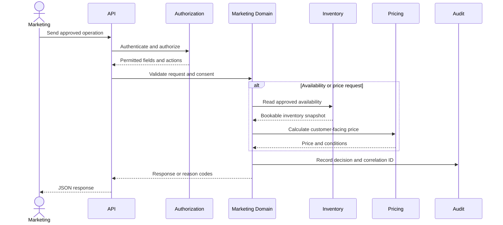

# TRD - Marketing Role

## Document Information

- Feature Name: Marketing Role
- Author: joud-alali
- Date:
- Version:

## Table of Contents

- [Background](#background)
- [In Scope](#in-scope)
- [Constraints](#constraints)
- [Technical Requirements](#technical-requirements)
  - [Database Design](#database-design)
  - [Frontend](#frontend)
  - [Backend](#backend)
- [Security Requirement](#security-requirement)
- [Non-Functional Requirements](#non-functional-requirements)
- [AI usage disclaimer](#ai-usage-disclaimer)

## Background

This TRD defines the technical implementation requirements for the Marketing Role functional requirements in [Marketing Role PRD](../prd/marketing-role-prd.md). It covers approved customer-facing products and availability, marketing offers and campaigns, consent-aware communications, partner attribution, feedback, reporting, and privacy-conscious marketing access.

Business decisions that remain open in the PRD are design inputs, not assumptions. Final segments, channels, price rules, attribution settings, locales, targets, and retention periods must be configured by authorized owners before launch.

## In Scope

- Management and reporting of approved customer segments and marketable rental products.
- Management of channel and source taxonomy for leads and bookings.
- Customer-facing availability and price views based on approved operational data.
- Eligibility-controlled offers and campaign attribution.
- Consent-aware marketing and service communication records.
- Partner-originated lead and booking attribution.
- Post-rental feedback collection and restricted feedback reporting.
- Marketing-specific access controls, audit records, and dashboard data.
- Integration contracts and failure tracking for analytics, CRM, and campaign tools.

## Constraints

- Final channel, segment, locale, offer, SLA, and target values remain configurable and are not prescribed by this TRD.
- Operational fleet management, payment processing, and detailed pricing-rule engines are outside this TRD.
- No payment credentials, driver-license details, emergency contacts, or unapproved PII are included in marketing views.
- Internal availability and pricing logic must not be exposed in customer-facing APIs.
- A specific analytics, CRM, BI, or partner-vendor implementation is not assumed.
- This TRD does not supersede a documented privacy, retention, or consent decision.

## Technical Requirements

### Database Design

The database design and entity relationship diagram are defined in [Database Design - Marketing Role](database-design-marketing-role.md). The design includes customer segments, rental products, sales channels, availability snapshots, offers, campaigns, leads, booking attributions, communication preferences, communications, partner bookings, feedback, and marketing audit records.

### Frontend

- Marketing-facing screens must provide validation for required fields and inline, field-specific error messages.
- Customer-facing price and availability data must display the applicable location, dates, channel, product, relevant conditions, and any date or currency assumptions.
- Offer terms, validity, redemption limits, and exclusions must be visible before submission and again during booking.
- Guaranteed vehicles and vehicle categories or example models must be clearly distinguished.
- Segmentation and report controls must restrict available filters and fields to approved marketing attributes.
- Customer communication preference controls must allow opt-out for marketing while preserving required service communications.
- Interfaces must use the approved locale, currency, date/time format, and language; unsupported locales must fail to a documented fallback.
- Sensitive operational and PII fields must not be rendered or included in page data unless explicitly authorized.
- UI elements must be responsive and remain usable on approved device sizes.

### Backend

The backend should expose REST APIs using JSON. APIs must support authentication and authorization, pagination for collection responses, stable identifiers, optimistic or idempotent behavior where applicable, and a correlation identifier for tracing. Money is represented with an exact decimal value and an ISO currency code.

#### Common validation

- Identifier values must use the platform's approved opaque identifier format.
- Required text fields must not be empty; unbounded text fields must be stored as text and constrained only where a business rule requires it.
- Dates must use an ISO 8601 date or timestamp format and must include timezone information for timestamps.
- Currency must be a valid ISO 4217 code and decimal precision must not exceed the configured currency rules.
- Channel, segment, product, campaign, offer, and partner identifiers must refer to approved active records.
- Marketing communication recipients must pass consent, opt-out, locale, and eligibility checks.
- API errors must use a consistent machine-readable code, human-readable message, field details where applicable, and trace identifier.

#### APIs

**Create or update a marketable product**

- `POST /api/v1/marketing/products`
- `PATCH /api/v1/marketing/products/{product_id}`
- Path parameter: `product_id` for PATCH.
- Request body: approved name, segment identifiers, rental types, supported locations, display attributes, booking status, and effective dates.
- Query parameters: none.
- Response body: product identifier and its effective, approved configuration.
- Only operations and product owners may approve operational status changes. Marketing may change only approved customer-facing fields.

**Resolve customer-facing availability and price**

- `GET /api/v1/marketing/availability`
- Query parameters: location identifier, start date, end date, product or vehicle category identifier, channel identifier, currency, locale, and optional page parameters.
- Response body: bookable availability entries, applicable price, currency, eligibility conditions, guaranteed/category/model labels, and refresh timestamp.
- The service must obtain availability and calculate price through approved inventory and pricing systems. It must not expose internal rule definitions or operational records.

**Create or manage an offer**

- `POST /api/v1/marketing/offers`
- `PATCH /api/v1/marketing/offers/{offer_id}`
- Request body: code or identifier, name, type, eligible segments, products, channels, validity range, redemption limit, and customer-facing terms.
- Response body: offer identifier and current status.
- Booking eligibility must be revalidated server-side, without trust in client-supplied status or discount values.

**Register lead or booking attribution**

- `POST /api/v1/marketing/attributions`
- Request body: lead or booking identifier, channel identifier, source identifier, campaign identifier when known, partner identifier when applicable, attribution model version, attribution timestamp, and touchpoint data explicitly approved for storage.
- Response body: attribution identifier, known source fields, and an attribution status indicating complete or limited attribution.
- Attribution gaps must be retained as unknown or unavailable; the API must not infer or silently fill missing data.

**Validate an offer at booking**

- `POST /api/v1/marketing/offers/{offer_id}/validate`
- Path parameter: offer identifier.
- Request body: booking identifier or draft booking details, customer identifier or approved anonymous context, channel, product, location, dates, and submitted code.
- Response body: eligible status, reason codes, validated redemption amount or discount reference, and terms version.
- The backend must reapply product, channel, date, segment, stacking, redemption, and partner eligibility rules.

**Create a marketing audience**

- `POST /api/v1/marketing/audiences`
- Request body: segment identifiers, purpose, channel, consent rule version, filters limited to approved data, and optional campaign identifier.
- Response body: audience identifier, estimated size, purpose, consent rule version, and calculation status.
- The service must exclude suppressed or opted-out contacts and must produce an auditable list of matching identifiers only for authorized consumers.

**Send or schedule a communication**

- `POST /api/v1/marketing/communications`
- Request body: communication type, template identifier, recipient identifier, booking or rental identifier when relevant, channel, approved content variables, schedule time, and consent/purpose reference.
- Response body: communication identifier, status, and scheduled or queued timestamp.
- Necessary service communications and marketing communications must use separate purposes and authorization rules.

**Submit and report feedback**

- `POST /api/v1/marketing/rentals/{rental_id}/feedback`
- Path parameter: rental identifier.
- Request body: rating, approved optional comment, channel, locale, and submission timestamp.
- Response body: feedback identifier and receipt status.
- Identifiable feedback must be hidden from broad marketing reports. Aggregated reporting APIs must return approved dimensions and suppress small or otherwise privacy-sensitive cohorts.
- `GET /api/v1/marketing/feedback/summary` query parameters: from date, to date, segment or channel identifiers, and aggregation period. The response contains counts, rate, rating distribution, and applicable suppression markers.

**Marketing reports**

- `GET /api/v1/marketing/reports/funnel`
- `GET /api/v1/marketing/reports/bookings`
- `GET /api/v1/marketing/reports/campaigns`
- Query parameters: from date, to date, channel, campaign, segment, product, location, currency, and pagination or aggregation parameters.
- Responses must contain approved metrics, source-of-truth version or refresh time, and attribution limitations.

#### General API sequence

For booking offer validation, the marketing service must validate the offer in the same transaction or coordinated flow used for booking so that eligibility can be rechecked at redemption. Campaign and partner data must be attached only to the attributed lead or booking and must not alter inventory or pricing results.

## Security Requirement

- All APIs require authenticated sessions or service credentials and role-based authorization.
- JWTs, when used, must use an approved asymmetric signing algorithm and short-lived access tokens. The payload must contain subject, approved role or scope, issuer, audience, issued-at, and expiration claims; PII must not be placed in the token.
- Marketing roles receive no payment, identity-document, emergency-contact, or general operational permissions unless a separate authorization and privacy approval exist.
- Operations and pricing permissions must remain independent from marketing configuration permissions.
- Every create, update, eligibility override, audience export, communication send, and report access must generate a tamper-evident audit record containing actor, action, object, purpose, timestamp, and correlation identifier.
- Apply least-privilege database access, encryption in transit and at rest, secure secret storage, and secret rotation.
- Sensitive exports and identifiable feedback must require additional authorization and must be retained only for approved periods.
- Input, output, and log fields must be checked to prevent PII leakage and cross-channel data exposure.
- Integrations must use credentialed, scoped service identities, signed or mutually authenticated transport where required, replay protection where relevant, and private data retention controls.

## Non-Functional Requirements

Leave blank

## AI usage disclaimer

*This document was generated with the assistance of artificial intelligence and should be reviewed by a human for accuracy and completeness.*
